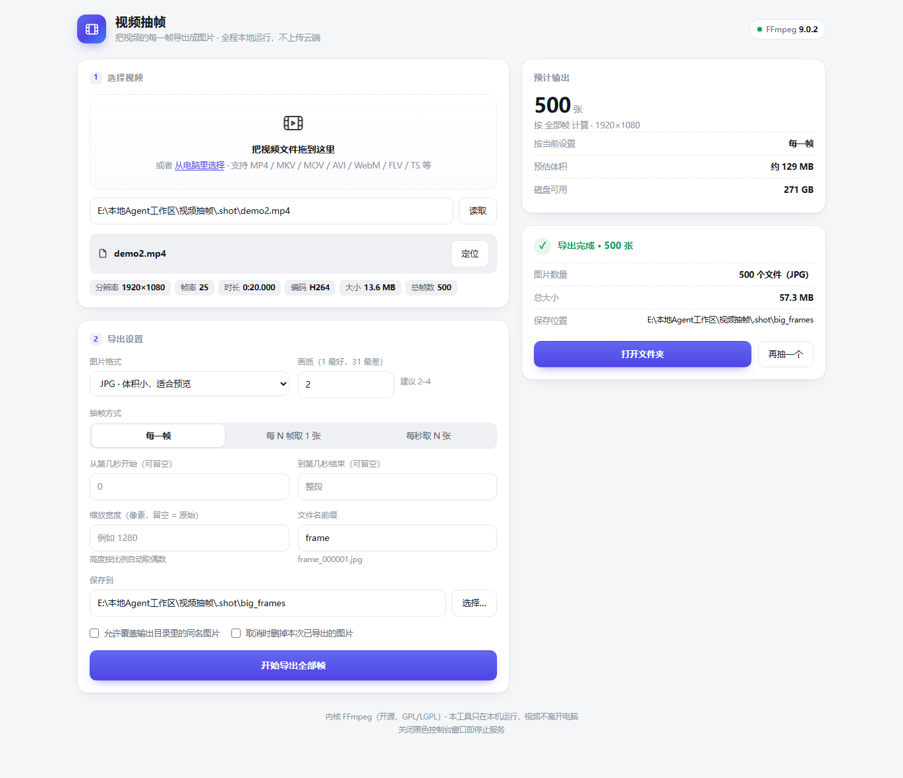

# Video Frame Extractor

**Export every frame of a video as images** — a small local web app with drag & drop, live progress, and no cloud in the loop. Powered by FFmpeg, written with zero npm dependencies.

[中文说明](README.zh-CN.md) · [License](LICENSE) · [Third-party notice](NOTICE)



Pick a video, press one button, get `frame_000001.png … frame_001234.png` in a folder next to it.

## Why another one?

Frame extraction is a solved problem — FFmpeg does it perfectly. What is missing on Windows is a **simple, local, no-install-required front end**: the existing open-source GUIs ([FFmpeg Batch AV Converter](https://sourceforge.net/projects/ffmpeg-batch/), [Videomass](https://github.com/jeanslack/Videomass), [Avidemux](https://avidemux.sourceforge.net/), [FrameExtract](https://github.com/Jasonsu22/FrameExtract)) are either encoder-oriented, capped at 9999 frames, or built around picking single frames.

This project is deliberately a **thin shell**: `server.mjs` (≈700 lines, Node built-ins only) assembles the FFmpeg command line, streams its progress, and counts the result. All decoding is FFmpeg's job.

## Features

- **Exact "every frame"** — `-fps_mode passthrough`, so variable-frame-rate sources are not padded or dropped
- **Formats**: PNG (lossless), JPG, WebP, BMP, TIFF
- **Sampling**: every frame · every N-th frame · N frames per second
- **Trim** by start/end time, **resize** by width (height stays even), custom filename prefix
- **Preflight**: frame count, rough output size and free disk space before you start
- **Live progress** over SSE — frames written, frames per second, ETA — and a working Cancel button
- **Overwrite guard** — refuses to write into a folder that already holds a sequence with the same prefix
- Three ways in: drag & drop, native Windows file dialog, or paste a path
- Binds to `127.0.0.1` only, no telemetry, no network calls, no fonts/CDNs — works offline

## Requirements

| | |
| --- | --- |
| OS | Windows 10/11 for the full experience (native file pickers). macOS/Linux work through the path input and are fine for the API. |
| Node.js | 18 or newer |
| FFmpeg | 5.1+ for `-fps_mode`; 7/8/9 recommended. `ffprobe` optional but strongly recommended. |

## Quick start

```bat
git clone https://github.com/isolation3355336/video-frame-extractor.git
cd video-frame-extractor

rem one-time: download FFmpeg into bin\ffmpeg\ (~170 MB unpacked)
powershell -NoProfile -ExecutionPolicy Bypass -File tools\fetch-ffmpeg.ps1

rem run
start.cmd
```

The browser opens `http://127.0.0.1:47820`. Closing the console window stops the server.

Already have FFmpeg? Copy `ffmpeg.exe` and `ffprobe.exe` into `bin\ffmpeg\`, or point to them:

```bat
set VFE_FFMPEG=D:\tools\ffmpeg\bin\ffmpeg.exe
set VFE_FFPROBE=D:\tools\ffmpeg\bin\ffprobe.exe
```

`npm start` / `node server.mjs --port 47821 --no-open` are equivalent entry points.

## Settings

| Setting | Meaning |
| --- | --- |
| Format | PNG lossless · JPG (quality 1–31, lower is better, 2–4 recommended) · WebP · BMP · TIFF |
| Sampling | **Every frame** (default) · every N-th frame · N frames per second |
| Start / end (seconds) | Trim a range; leave empty for the whole video |
| Resize width | Empty = native resolution; height follows, rounded to an even number |
| Filename prefix | `frame` → `frame_000001.png` (six-digit, starting at 1) |
| Output folder | Empty = `<video-dir>\<name>_frames` |
| Allow overwrite | Off by default; refuses to reuse a folder that already has the same sequence |
| Delete on cancel | Off by default; keeps already-written frames |

## Output

```
frame_000001.png
frame_000002.png
...
```

Rough size per frame (actual size depends on content):

| Resolution | PNG | JPG (q=2) |
| --- | --- | --- |
| 1280×720 | 0.6–1.5 MB | 150–350 KB |
| 1920×1080 | 1.3–3 MB | 250–600 KB |
| 3840×2160 | 5–12 MB | 1–2.5 MB |

Full-frame export of a long 4K clip can easily reach tens of GB — check the **free disk** value on the page first, or switch to JPG / every-N-th frame.

## HTTP API

Everything the UI does is a plain JSON call, so the app is easy to script:

| Endpoint | Purpose |
| --- | --- |
| `GET /api/env` | FFmpeg/FFprobe paths and versions, free space |
| `POST /api/probe` `{path}` | duration, resolution, fps, codec, frame count |
| `POST /api/count` `{path}` | exact frame count (demux only, no decoding) |
| `POST /api/start` `{input, outDir, format, mode, …}` | start a job, returns `{id, outDir, expected}` |
| `GET /api/events?id=` | SSE stream of progress |
| `GET /api/job?id=` | current snapshot (polling / debugging) |
| `POST /api/cancel` `{id, clean}` | stop the job, optionally delete what it wrote |
| `POST /api/pick` `{kind: "video"\|"dir"}` | native file / folder dialog (Windows) |
| `POST /api/reveal` `{path, select}` | open Explorer / Finder at a path |
| `POST /api/upload?name=` | raw body → temp file, for drag & drop |

```bash
curl -s -X POST http://127.0.0.1:47820/api/start \
  -H 'Content-Type: application/json' \
  -d '{"input":"D:\\clip.mp4","format":"png","mode":"all"}'
```

## How it works

- `server.mjs` — no dependencies. Spawns FFmpeg with `-progress pipe:1`, turns the key/value stream into SSE events, counts the produced files on exit.
- Exact frames come from `-fps_mode passthrough` (FFmpeg ≥ 5.1) or `-vsync 0` on older builds, so nothing is duplicated or dropped.
- Frame count uses `ffprobe`'s `nb_frames`, then `nb_read_packets`, then `duration × fps` as a labelled estimate.
- WebP stills need `-f image2 -c:v libwebp`; without it FFmpeg selects the animated-WebP muxer and silently writes one file.
- `app/index.html` — one file, no framework, no build step, light/dark aware.

## Tests

```bash
npm test
```

`tools/smoke.mjs` generates its own 100-frame clip with `lavfi`, starts the server on a spare port and asserts 40 things: exact frame counts, first/last filenames, PNG/JPEG/WebP magic bytes, sampling modes, trimming, resizing, Chinese paths in and out, overwrite protection, cancellation, uploads, and the PowerShell picker scripts (parsed, not shown).

## Limitations

- The UI is Chinese in v1 — PRs for i18n are welcome.
- One job at a time (FFmpeg saturates CPU/disk anyway).
- Drag & drop copies the file into the OS temp folder first; for multi-GB files use the file picker, which reads in place.
- Native dialogs are Windows-only; elsewhere paste the path.

## License

GNU General Public License v3.0 — see [LICENSE](LICENSE).
Copyright (C) 2026 isolation3355336.

FFmpeg is licensed separately (most Windows builds are GPL as well); its binaries are not part of this repository and keep their own license. See [NOTICE](NOTICE).
