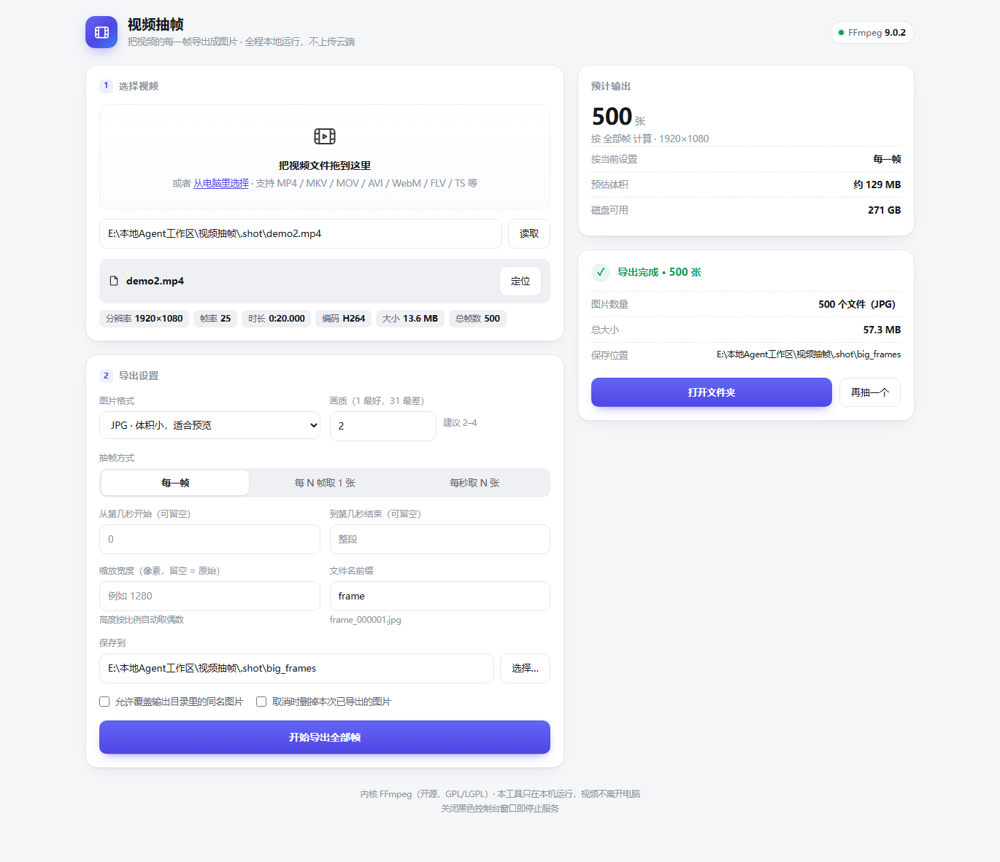
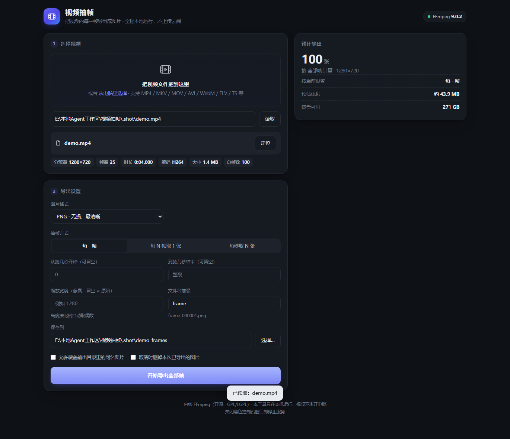

# 视频抽帧 · Video Frame Extractor

把一个视频的**每一帧**导出成图片（PNG / JPG / WebP / BMP / TIFF）。本地网页界面、拖进去点一下就行、零 npm 依赖，底层调用 FFmpeg。

[English](README.md) · [许可证](LICENSE) · [第三方说明](NOTICE)




---

## 为什么还要再做一个

抽帧本身是 FFmpeg 的强项，问题不在能力而在**顺手**。现成的开源 GUI 里，[FFmpeg Batch AV Converter](https://sourceforge.net/projects/ffmpeg-batch/) 偏转码、参数面板专业；[Videomass](https://github.com/jeanslack/Videomass) 同样以转码为中心；[Avidemux](https://avidemux.sourceforge.net/) 的旧版本一次最多 9999 帧、只出 JPEG 序列；[FrameExtract](https://github.com/Jasonsu22/FrameExtract) 更偏「挑单帧」。

所以这里的定位很清楚：**只做一层壳**。`server.mjs`（约 700 行，只用 Node 内置模块）负责拼 FFmpeg 命令行、读它的进度、数产出；解码全部交给 FFmpeg。

## 功能

- **真正的「每一帧」**：`-fps_mode passthrough`，VFR（可变帧率）视频不补帧、不丢帧
- **格式**：PNG（无损）/ JPG / WebP / BMP / TIFF
- **抽帧方式**：每一帧 · 每 N 帧取 1 张 · 每秒取 N 张
- **截段**（起止秒）· **缩放宽高**（保持比例）· **自定义文件名前缀**
- **开跑前给数**：总帧数、预估体积、磁盘可用空间
- **实时进度**（SSE）：已导出帧数、帧/秒、预计剩余，可随时取消
- **覆盖保护**：输出目录里已有同前缀同格式的序列时直接拦下，不会悄悄覆盖
- 三种添加方式：拖拽 · Windows 原生文件框 · 粘贴路径
- 只监听 `127.0.0.1`，无遥测、无外部请求、不依赖 CDN，断网可用

## 环境要求

| 项 | 要求 |
| --- | --- |
| 系统 | Windows 10/11 体验最完整（原生文件框）。macOS / Linux 可用路径输入框，命令行与 HTTP 接口完全可用 |
| Node.js | 18 及以上 |
| FFmpeg | 5.1+（需要 `-fps_mode`），推荐 7/8/9；`ffprobe` 可选但强烈建议 |

## 快速开始

```bat
git clone https://github.com/isolation3355336/video-frame-extractor.git
cd video-frame-extractor

rem 一次性：下载 FFmpeg 到 bin\ffmpeg\（解压后约 170 MB）
powershell -NoProfile -ExecutionPolicy Bypass -File tools\fetch-ffmpeg.ps1

rem 启动
start.cmd
```

浏览器会自动打开 `http://127.0.0.1:47820`。**关掉黑色控制台窗口即停止服务。**

已经有 FFmpeg？把 `ffmpeg.exe`、`ffprobe.exe` 放进 `bin\ffmpeg\`，或用环境变量指定：

```bat
set VFE_FFMPEG=D:\tools\ffmpeg\bin\ffmpeg.exe
set VFE_FFPROBE=D:\tools\ffmpeg\bin\ffprobe.exe
```

`npm start` 与 `node server.mjs --port 47821 --no-open` 等价，端口被占用时用 `--port` 换一个。

## 设置项

| 设置 | 说明 |
| --- | --- |
| 图片格式 | PNG 无损（最清晰、最大）· JPG（画质 1–31，数字越小越好，建议 2–4）· WebP · BMP · TIFF |
| 抽帧方式 | **每一帧**（默认）· 每 N 帧取 1 张 · 每秒取 N 张 |
| 开始 / 结束（秒） | 只导出其中一段；留空为整段 |
| 缩放宽度 | 留空 = 原始分辨率；高度自动按比例并取偶数 |
| 文件名前缀 | 默认 `frame`，输出 `frame_000001.png`（6 位补零，从 1 开始） |
| 保存到 | 留空 = 视频旁边的 `<视频名>_frames` |
| 允许覆盖 | 默认关闭；关闭时若目录已有同前缀序列会报错 |
| 取消时删除 | 默认关闭；取消后已写出的帧保留 |

## 输出与体积

```
frame_000001.png
frame_000002.png
...
```

单帧体积粗估（实际取决于画面复杂度）：

| 分辨率 | PNG/帧 | JPG(q=2)/帧 | 1 分钟 30fps 的 PNG 总量 |
| --- | --- | --- | --- |
| 1280×720 | 0.6–1.5 MB | 150–350 KB | 1.1–2.7 GB |
| 1920×1080 | 1.3–3 MB | 250–600 KB | 2.3–5.4 GB |
| 3840×2160 | 5–12 MB | 1–2.5 MB | 9–21 GB |

页面上的「预估体积」按经验系数粗算，只用于判断「要不要换 JPG / 缩小 / 抽稀」。**全帧导出 4K 长片前先看磁盘可用空间。**

## HTTP 接口

界面做的事都是普通 JSON 调用，脚本化很容易：

| 接口 | 作用 |
| --- | --- |
| `GET /api/env` | FFmpeg / FFprobe 路径与版本、磁盘剩余 |
| `POST /api/probe` `{path}` | 时长、分辨率、帧率、编码、帧数 |
| `POST /api/count` `{path}` | 精确总帧数（只解封装，不解码） |
| `POST /api/start` `{input, outDir, format, mode, …}` | 建任务并启动，返回 `{id, outDir, expected}` |
| `GET /api/events?id=` | SSE 实时进度 |
| `GET /api/job?id=` | 任务快照（轮询 / 排查） |
| `POST /api/cancel` `{id, clean}` | 取消，可选删除本次产出 |
| `POST /api/pick` `{kind: "video"\|"dir"}` | 原生文件 / 文件夹对话框（Windows） |
| `POST /api/reveal` `{path, select}` | 资源管理器 / Finder 定位 |
| `POST /api/upload?name=` | 原始流写入临时文件（拖拽用） |

```bash
curl -s -X POST http://127.0.0.1:47820/api/start \
  -H 'Content-Type: application/json' \
  -d '{"input":"D:\\clip.mp4","format":"png","mode":"all"}'
```

## 实现要点

- `server.mjs`：零依赖。用 `-progress pipe:1` 读 FFmpeg 的键值流，转成 SSE；退出后数文件、汇总体积。
- 「所有帧」靠 `-fps_mode passthrough`（FFmpeg ≥ 5.1，更老的版本用 `-vsync 0`），不做重复/丢弃。
- 帧数优先取 `ffprobe` 的 `nb_frames`，其次 `nb_read_packets`，最后用 `时长 × 帧率` 估算并标注「估算」。
- WebP 静图必须显式写 `-f image2 -c:v libwebp`：否则 FFmpeg 会选动图封装器，只吐出一个文件。
- `app/index.html`：单文件，无框架、无构建步骤，自适应浅色/深色。

## 自测

```bash
npm test
```

`tools/smoke.mjs` 会用 `lavfi` 造一段 100 帧的测试视频，在空闲端口起服务，断言 40 项：全帧数量、首末文件名、PNG/JPEG/WebP 文件头、采样方式、截段、缩放、**中文路径**进出、覆盖保护、取消、上传，以及两个 PowerShell 对话框脚本的语法（只解析不弹窗）。

## 已知限制

- 界面目前只有中文（v1），欢迎提 i18n PR
- 同时只能跑一个任务（多个 FFmpeg 只会互相抢 CPU 和磁盘）
- 拖拽会把视频复制到系统临时目录；几 GB 的片子请用文件框，直接读原文件
- 原生对话框只支持 Windows，其他系统请粘贴路径

## 许可证

GPL-3.0，见 [LICENSE](LICENSE)。Copyright (C) 2026 isolation3355336。

FFmpeg 单独授权（Windows 常见构建同样是 GPL），二进制**不随仓库分发**，见 [NOTICE](NOTICE)。
